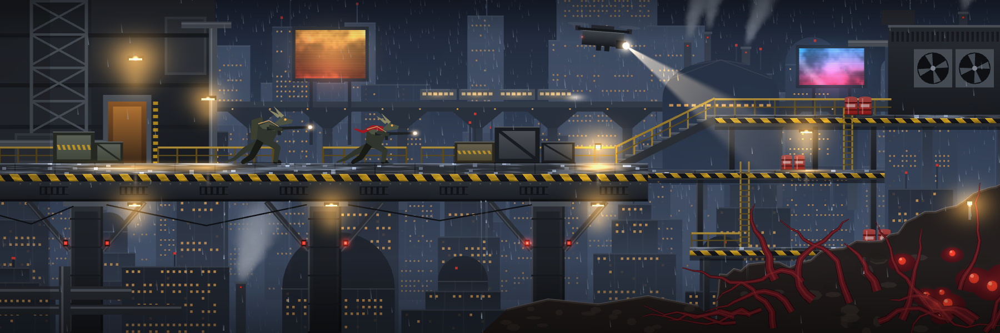
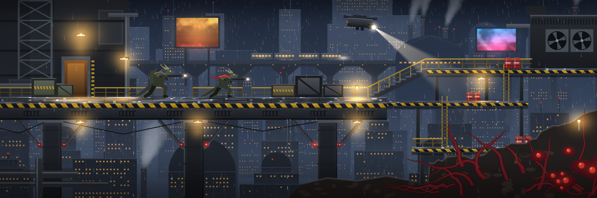
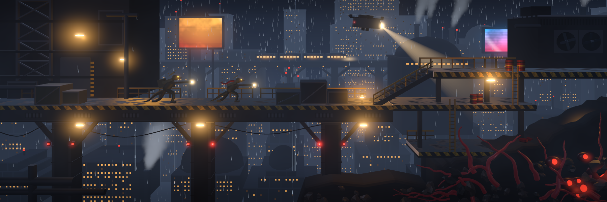
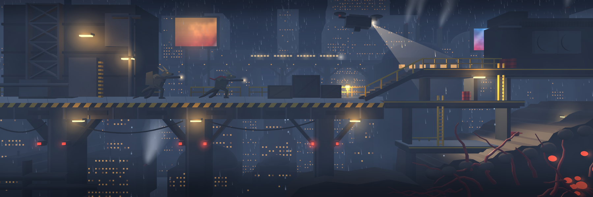

# Framework evaluation: three.js vs PixiJS

One procedural scene, the Technophage "surface megacity", is built four ways and measured
with one benchmark harness, to choose a rendering framework for game development:

| build | framework | approach |
|---|---|---|
| three.js 2D | three 0.187.0 | orthographic camera, flat parallax layers, custom shaders |
| three.js 3D | three 0.187.0 | perspective camera, real geometry, lights, fog, optional bloom |
| PixiJS 2D | pixi.js 8.23.0 | Graphics, Mesh + custom shaders, parallax containers |
| PixiJS 3D | pixi.js 8.23.0 + @pixi/3d 0.1.0 | View3D, real geometry, lights, fog |

Everything is made in code: geometry, shaders, particles and lights. No bitmap images are
loaded or committed. All four builds draw the same scene data from `shared/scene.js`, with
the same seed and the same animation timing, so differences come from the frameworks.

**Recommendation (judgement, reasons in [Recommendation](#recommendation)):** PixiJS for a
2D game such as Technophage. three.js if the game needs real 3D now, because `@pixi/3d` is
a beta 0.1.0 release.

-----

## Contents

1. [Versions](#versions)
2. [Screenshots](#screenshots)
3. [How to run](#how-to-run)
4. [Benchmark method](#benchmark-method)
5. [Performance](#performance)
6. [Features used and missing](#features-used-and-missing)
7. [Flexibility](#flexibility)
8. [Ease of development](#ease-of-development)
9. [TypeScript, documentation and ecosystem](#typescript-documentation-and-ecosystem)
10. [Recommendation](#recommendation)
11. [Layout of this folder](#layout-of-this-folder)

-----

## Versions

All pinned exactly in the `package.json` files; `package-lock.json` is committed.
Each was the latest stable release on npm on 2026-11-15 (checked with `npm view <package> version`).

| package | version | note |
|---|---|---|
| `three` | 0.187.0 | |
| `@types/three` | 0.187.0 | three.js ships no type declarations; these come from DefinitelyTyped |
| `pixi.js` | 8.23.0 | published 2026-11-11 |
| `@pixi/3d` | 0.1.0 | first published 2026-11-12. The official PixiJS 3D package (github.com/pixijs/3d, author PixiJS). Labelled **beta** on [pixijs.com/3d](https://pixijs.com/3d). npm dist-tags: `latest` 0.1.0, `beta` 0.1.0-beta.3. Peer dependency `pixi.js ^8.23.0` |
| `vite` | 8.3.8 | build and dev server |
| `typescript` | 7.0.2 | type-check only (`checkJs`, strict); the code is JavaScript with JSDoc |

-----

## Screenshots

All at `t=12` (animation frozen at 12 s), base stress level, 1800×600, captured by
`npm run screenshots`. The reference image is not committed (it is archived material);
the descriptions below compare against it.

**Reference, described:** a painted pixel-art side view, 2172×724. A wet steel walkway with
yellow-black hazard edges crosses the left two-thirds, on concrete pillars with red warning
lights and dripping water. Two armoured lizard-like hunters crouch on it with rifles.
Crates and barrels, amber lamps. Stairs, ladders and stepped platforms rise to the right,
over dark rock covered in red fleshy growth with glowing pods. Behind: a dense, dark,
blue-grey megacity in several layers, a train on an elevated track, two glowing
billboards, smoke stacks, and a drone with a searchlight. Heavy rain throughout.

### three.js 2D

### PixiJS 2D

### three.js 3D (bloom off: the build compared with PixiJS 3D)

### three.js 3D with bloom

### PixiJS 3D

### How close each build is to the reference

These are judgements from looking at the images side by side, except the one measured
pixel difference.

| | three.js 2D | PixiJS 2D | three.js 3D | PixiJS 3D |
|---|---|---|---|---|
| layout and every listed element | yes | yes | yes | yes |
| palette and mood | close; city a little bluer and lighter than the reference | same as three.js 2D | close; strongest lamp glow of the four (bloom variant) | close; same mist layer as three.js 3D, lamps weaker |
| wet reflections | painted light pools and streaks (shader) | same | real lit reflections, small highlights rather than long streaks | low-roughness material only; faint |
| lamps light surfaces | no: additive glow only | no: additive glow only | yes: real point lights | yes: real point lights |
| growth | thin red tendrils | same | tube geometry, thicker, with glowing pods | tube geometry, thinner |
| main gap | flat vector look, no painted texture or fine detail | same | low-detail hunters and crates, flat rock | same, plus thin smoke |

**Measured:** the two 2D builds render almost the same image. At `t=12` the PixiJS 2D
screenshot differs from the three.js 2D one by a mean of 0.39 out of 255 per pixel; 0.14% of
pixels differ by more than 16. The differences are circle tessellation and polygon
triangulation (PixiJS uses earcut, three.js its own triangulator).

None of the four reaches the reference's detail: the reference is painted pixel art, and the
builds are procedural vector shapes and primitives.

-----

## How to run

Run everything from `framework-evaluations/`. Needs Node.js 22 or later (tested with 26.3.1).

1. Install: `npm ci`
   - check: `npm ls three pixi.js @pixi/3d` # prints 0.187.0, 8.23.0, 0.1.0
2. Build both projects for production: `npm run build`
   - output goes to `threejs/dist/` and `pixijs/dist/` (not committed)
3. Type-check: `npm run typecheck` # expect no output and exit code 0
4. Dev servers: `npm run dev` # three.js on http://localhost:5173, PixiJS on http://localhost:5174
   - pages: `/2d.html` and `/3d.html` on each port
   - one framework only: `npm run dev:threejs` or `npm run dev:pixijs`
   - if a port is taken, Vite stops with "Port 5173 is already in use": free the port first

Page options, the same in every build:
`2d.html?rain=64000&lights=8&objects=1&seed=1&t=12.5`

| option | meaning |
|---|---|
| `rain` | rain particle count (base 4000) |
| `lights` | lamps / light sources (base 8) |
| `objects` | multiplier for crates, barrels and buildings (base 1) |
| `seed` | seed for the procedural content |
| `t` | freeze the animation at this time in seconds (screenshots) |
| `sync=1` | wait for the GPU after every frame (the benchmark sets it; see below) |
| `bloom=0` / `bloom=1` | three.js 3D only: bloom pass off / on (default on) |

-----

## Benchmark method

### Commands

The runner drives the dedicated Chromium through the chromium-automation skill's library.
Set `CDP_LIB` to the absolute path of that library's `scripts/cdp.mjs`; the runner stops
with a message if it is unset.

1. `export CDP_LIB=/absolute/path/to/chromium-automation/scripts/cdp.mjs`
2. Close other GPU-heavy programs and leave the machine idle for the whole run.
3. Full run: `npm run bench` # builds, then every build × every stress level, 3 repeats (about 7 minutes here)
4. Readback cost run: `npm run bench -- --no-build --no-sync --levels base` # base level only, same frame counts and repeats as the full run; writes `bench/results/results-nosync.json` (about 1 minute)
5. Screenshots: `npm run screenshots`
6. Tables: `npm run report` # prints every table in this section from the results files; it also warns if some levels were measured in an earlier session (after `--levels`)
7. Lines of code: `npm run loc`

Check after a run: `npm run report` prints an Environment table. `GPU` must name the real
GPU (not SwiftShader) and `frame rate uncapped` must be `true`. If `GPU` names SwiftShader,
Chromium did not get GPU access: the runner's flags (below) are what fixed that here.

Other options: `--only threejs-2d,pixijs-2d`, `--levels base,rain-16000` (some stress levels
only), `--no-build` (reuse `dist/`), `--quick` (base level only, one repeat, fewer frames),
`--headed`.

### Environment of the recorded results

| item | value |
|---|---|
| browser | Chromium 153.0.8010.52, headless |
| GPU | ANGLE (AMD, AMD Radeon 760M Graphics (radeonsi phoenix LLVM 20.1.2), OpenGL 4.6) |
| CPU | AMD Ryzen 5 8645HS, 12 threads, 16 GB RAM |
| OS | Linux 7.0.0-38-generic |
| Node.js | 26.3.1 |
| resolution | 1800×600 canvas, device pixel ratio 1, WebGL2 in every build. Antialias on in the canvas, except three.js 3D with bloom, which turns canvas antialias off and renders into a 4-sample multisampled target instead |
| Chromium flags | `--ignore-gpu-blocklist --enable-gpu --disable-gpu-vsync --disable-frame-rate-limit --disable-renderer-backgrounding --disable-background-timer-throttling --force-device-scale-factor=1 --window-size=1800,600` |
| recorded | 2026-11-15 (UTC+0), machine idle: full run 21:22:54–21:29:49, run without readback 21:29:49–21:30:36. A later code-review change moved the three.js 3D sky and mist out of the layer list without changing what is drawn; it changed the three.js 3D bundle by −26 bytes minified and −7 bytes gzip, and the PixiJS 3D bundle by +2 bytes minified and −2 bytes gzip (measured with `npm run build`); performance was not re-measured |

Flags: without `--ignore-gpu-blocklist --enable-gpu`, headless Chromium on this machine
used SwiftShader (software WebGL). Without `--disable-gpu-vsync --disable-frame-rate-limit`,
`requestAnimationFrame` was capped at 16.7 ms, so frame time would have measured the
display rate, not the work.

### What is measured

| metric | how |
|---|---|
| frame time | `requestAnimationFrame` interval, 60 warm-up frames then 300 sampled frames; mean, p95, p99 |
| JS + submit time | time inside the build's frame function before the GPU wait (CPU cost) |
| stress levels | one axis at a time from the base level: rain 4k / 16k / 64k / 256k, lights 8 / 32 / 128, objects ×1 / ×4 / ×16 |
| repeats | 3 fresh page loads per level. The tables show every figure from one run: the run whose mean is the median of the 3 means. The range of the 3 means is recorded too |
| start-up | 5 fresh loads; median of each timing separately (so the timings can come from different loads), from navigation start to the first rendered frame |
| bundle size | the JS chunks each page loads after `vite build` (minified), and their gzip -9 size |
| memory | JS heap after a forced garbage collection (CDP `HeapProfiler.collectGarbage`, then `Runtime.getHeapUsage`), read once per level after the last of the 3 runs, so it is the one figure not taken from the median run |
| draw calls | the shared hook wraps every WebGL draw method, identically in all builds; three.js's own count (`renderer.info.render.calls`) is recorded too and matched the hook in every run. PixiJS and @pixi/3d report no draw count of their own |

### Read the frame times as a comparison, not as real frame rates

> [!IMPORTANT]
> Every frame time below comes from **headless Chromium with a one-pixel GPU readback after
> every frame** (`sync=1`). The readback makes each frame wait for the GPU, so the time
> includes GPU work. It also adds a cost to every frame and stops the browser from
> overlapping frames. **The absolute numbers are not what a player would see.** Use them to
> compare the builds with each other under the same conditions.

Why the readback is there: without it, the uncapped headless page queued frames and then
blocked for 100–500 ms at a time. p95 came out below the mean, which means the
percentiles described the queue, not the frames.

Size of the readback cost, base level, mean only. The run without `sync=1` used the same
frame counts and 3 repeats as the full run, but without the readback frames overlap and
queue, so its percentiles are not reliable and only means are shown:

| build | mean with sync=1 (ms) | mean without sync (ms) | difference (ms) |
|---|---:|---:|---:|
| three.js 2D | 4.84 | 1.47 | 3.37 |
| three.js 3D | 8.46 | 2.56 | 5.91 |
| three.js 3D + bloom | 8.95 | 3.84 | 5.10 |
| PixiJS 2D | 4.32 | 2.21 | 2.11 |
| PixiJS 3D | 6.00 | 2.02 | 3.99 |

The difference is not a fixed cost: it is the readback plus the overlap the browser loses,
and it varies by build.

The runs without the readback are much less consistent than the runs with it. Spread of
their 3 means: PixiJS 2D 1.35 / 2.21 / 2.40 ms (78%), three.js 3D + bloom 57%, three.js 3D
20%, three.js 2D 9%, PixiJS 3D 7%. So the no-readback means show roughly how large the
readback cost is, but they are not good enough to rank builds against each other.

### How much results varied

- **Within one run (3 repeats):** in the recorded run, 36 of 40 build-and-level results have
  the 3 means within 12% of each other, most within 5%. Four do not:
  - three.js 3D, rain 16k: 6.08 / 7.80 / 8.13 ms (34%)
  - three.js 3D, objects ×16: 8.61 / 8.81 / 6.75 ms (30%)
  - three.js 2D, rain 64k: 6.49 / 5.81 / 5.67 ms (15%)
  - three.js 3D + bloom, rain 16k: 9.00 / 8.04 / 8.83 ms (12.03%)

  The spread is the slowest run's mean minus the fastest's, divided by the fastest's.
- **Between sessions:** the same build and level gave different numbers on different runs
  on the same day. three.js 2D, base level, mean frame time with `sync=1`:

  | run | warm-up frames | machine | mean (ms) |
  |---|---:|---|---:|
  | quick check at 19:35 | 30 | not known to be idle | 9.5 |
  | provisional full run at 19:36 | 60 | not known to be idle | 5.7 |
  | full run at 20:36, before the review fixes | 60 | idle | 4.77 |
  | recorded full run at 21:22 | 60 | idle | 4.84 |

  The two runs on an idle machine agree within 2%; the earlier ones do not. Start-up times
  varied the same way: three.js 2D first frame 258 ms in a run at 19:31 (before the readback
  was added), 277 ms at 19:36, 163 ms at 20:36 and 153 ms at 21:22. The runs before 21:22 are
  in the runner's raw output files (`bench/results/raw/`, not committed); only the 21:22 run
  is in `results.json`. Possible causes, none confirmed: other programs using the machine, the
  GPU or CPU clock speed, a different number of warm-up frames.
- **What this means:** only differences between builds that are well above about 15–20%
  should be read as real. Repeat the full run before relying on smaller differences.

-----

## Performance

All numbers are from the recorded full run (`bench/results/results.json`) unless stated.
Each figure comes from the run with the median mean of 3; see the warning above about what
the frame times mean.

### Base level

| | three.js 2D | PixiJS 2D | three.js 3D | PixiJS 3D | three.js 3D + bloom |
|---|---:|---:|---:|---:|---:|
| frame time mean (ms) | 4.84 | 4.32 | 8.46 | 6.00 | 8.95 |
| frame time p95 (ms) | 5.4 | 5.0 | 9.7 | 7.1 | 10.2 |
| frame time p99 (ms) | 6.5 | 5.4 | 10.3 | 7.4 | 10.5 |
| JS + submit per frame (ms) | 1.40 | 0.42 | 1.13 | 0.61 | 1.32 |
| draw calls per frame | 98 | 59 | 108 | 52 | 122 |
| start-up to first frame (ms) | 153 | 195 | 313 | 227 | 363 |
| bundle minified (kB) | 617.7 | 375.2 | 644.7 | 919.6 | 644.7 |
| bundle gzip -9 (kB) | 158.9 | 118.8 | 166.2 | 278.4 | 166.2 |
| JS heap after GC (MB) | 3.8 | 13.3 | 5.0 | 7.0 | 5.4 |

### Stress levels: mean frame time (ms)

| level | three.js 2D | PixiJS 2D | three.js 3D | PixiJS 3D | three.js 3D + bloom |
|---|---:|---:|---:|---:|---:|
| base (rain 4k, lights 8, objects ×1) | 4.84 | 4.32 | 8.46 | 6.00 | 8.95 |
| rain 16k | 5.09 | 4.62 | 7.80 | 6.35 | 8.83 |
| rain 64k | 5.81 | 5.14 | 8.71 | 6.64 | 9.40 |
| rain 256k | 9.15 | 8.48 | 8.68 | 7.34 | 12.96 |
| lights 32 | 4.96 | 4.46 | 9.09 | 6.96 | 11.38 |
| lights 128 | 5.46 | 4.83 | 21.66 | 6.83 † | 24.39 |
| objects ×4 | 5.24 | 4.67 | 8.71 | 6.34 | 8.97 |
| objects ×16 | 6.13 | 4.99 | 8.61 | 6.61 | 9.05 |

† **Not like for like.** `@pixi/3d` shades at most 32 lights (`MAX_LIGHTS = 32` in
`node_modules/@pixi/3d/dist/core/lightLimits.mjs`) and drops the rest without a warning.
At 128 lights the PixiJS 3D build lights the scene with 32; three.js 3D shades all 128.
In the 2D builds "lights" are additive glow sprites, not lights.

The two 3D builds do the same work: no shadows in either, the same full-screen mist layer
in both, no post-processing (the bloom variant is listed separately).

Full tables (p95, p99, JS heap and draw calls for every level) come from `npm run report`.

### What the numbers show

Measured:

- **2D CPU cost:** PixiJS 2D spends less CPU time per frame than three.js 2D: 0.42 ms
  against 1.40 ms at the base level, and 0.40–0.52 ms against 1.30–1.47 ms across all levels.
  It also issues fewer draw calls (59 against 98).
- **2D frame time:** with the readback, PixiJS 2D has a lower mean than three.js 2D at every
  level, by 7–19%. Without the readback the base-level medians are 1.47 ms (three.js 2D) and
  2.21 ms (PixiJS 2D), but the PixiJS 2D runs ranged from 1.35 to 2.40 ms, so that run does
  not settle the order. Treat the 2D frame times as roughly equal.
- **3D:** PixiJS 3D has a lower mean than three.js 3D (bloom off) at every level except
  lights 128 (not comparable, see †): by 15–29% with the readback. Without it, at the base
  level, every PixiJS 3D run (1.95–2.09 ms) was faster than every three.js 3D run
  (2.20–2.64 ms).
- **Rain scaling:** from 4k to 256k drops, both 2D builds roughly double their frame time
  (three.js 4.84 → 9.15, PixiJS 4.32 → 8.48). The 3D builds grow less (three.js 8.46 → 8.68,
  PixiJS 6.00 → 7.34).
- **Lights:** three.js 3D grows from 8.46 ms (8 lights) to 21.66 ms (128 lights).
- **Bloom** (three.js `UnrealBloomPass`) adds 0.49 ms at the base level and 4.28 ms at rain 256k.
- **Memory:** PixiJS 2D has the largest JS heap (13.3 MB at base, 22.3 MB at objects ×16);
  three.js 2D the smallest (3.8 MB).
- **Bundle:** PixiJS 2D is the smallest (118.8 kB gzip); PixiJS 3D the largest (278.4 kB
  gzip), because it is pixi.js plus @pixi/3d.

Not explained (causes not investigated, so none is claimed): why the three.js 2D build
spends more CPU per frame than PixiJS 2D, why three.js 3D rain cost barely grows with the
drop count, and why the PixiJS 2D heap is larger. Possible causes include the two builds'
different batching (98 against 59 draw calls), per-object work in each framework's render
loop, and how each framework stores built shape geometry in JS memory.

-----

## Features used and missing

"Missing" means not in the framework package used here. Each was checked in the package
source in `node_modules` or the official docs.

### Used

| need | three.js | PixiJS 2D | @pixi/3d |
|---|---|---|---|
| 2D shapes | `ShapeGeometry`-style batches (own `ShapeBatch` over `BufferGeometry`), `ShapeUtils` triangulation | `Graphics` (`rect`, `poly`, `ellipse`, `fill`) | — |
| gradients | custom shader | `FillGradient` (renders a small texture at runtime) | — |
| custom shaders | `ShaderMaterial` (GLSL) | `Mesh` + `Shader` + `GlProgram` (GLSL ES 3.0) | `ShaderBit`s inserted into the built-in materials |
| GPU-animated particles (rain) | `InstancedBufferGeometry` | instanced `Geometry` attributes on a `Mesh` | `ShaderBit` on instanced geometry; per-drop data packed into position and UV |
| CPU particles (smoke, drips) | dynamic buffers | dynamic `Buffer` | `ParticleContainer3D` (`writePacked`, `upload`) |
| draw order | `renderOrder`, all materials transparent, depth test off | one sorted `RenderLayer` + `zIndex` | depth buffer |
| instancing | `InstancedMesh` | — | `BatchedMesh3D`, automatic instancing of meshes sharing a geometry |
| lights | `PointLight`, `SpotLight`, `HemisphereLight`, `DirectionalLight` | — | `PointLight`, `SpotLight` (shadows off, to match three.js 3D), `DirectionalLight`, hemisphere `environment` |
| materials | `MeshStandardMaterial` (PBR), `MeshLambertMaterial`, `MeshBasicMaterial` | — | `Material3D` (PBR), `FlatMaterial` (unlit) |
| fog / haze | `Fog`, with `ShaderChunk.fog_fragment` replaced by the shared haze curve; full-screen mist quad on the camera | per-layer colour + mist shader | exponential `fog` (one colour); the same full-screen mist as a 2D `Mesh` on the PixiJS stage above the `View3D` |
| reflections | procedural environment via `PMREMGenerator.fromScene` | painted in shader | low-roughness material only |
| geometry helpers | `ExtrudeGeometry`, `TubeGeometry`, `CatmullRomCurve3`, `mergeGeometries` | — | `CubeGeometry`, `PlaneGeometry`, custom `Geometry3D` |
| post-processing | `EffectComposer`, `RenderPass`, `UnrealBloomPass`, `OutputPass` (three.js 3D, optional) | none | none |

### Missing, and how the builds worked around it

| missing | framework | evidence | workaround |
|---|---|---|---|
| draw-call counter | pixi.js 8.23, @pixi/3d 0.1.0 | none found in either package's source | shared hook wraps WebGL draw methods |
| more than 32 shaded lights | @pixi/3d 0.1.0 | `dist/core/lightLimits.mjs`: `MAX_LIGHTS = 32`; extra lights dropped silently | drone spot light added first so it is never dropped |
| custom vertex attributes | @pixi/3d 0.1.0 | `Geometry3D` accepts fixed attribute names only (`Geometry3D.d.ts`) | rain data packed into position and UV |
| freezable shader time | @pixi/3d 0.1.0 | `uTime` set from `performance.now()` in `dist/core/gl/View3DPipeGl.mjs` | each animated material gets its own time value |
| externally driven particle clock | @pixi/3d 0.1.0 | `ParticleSystem3D` steps itself | smoke and drips written by hand to `ParticleContainer3D` |
| planar or screen-space reflections | @pixi/3d 0.1.0 | not in `dist/` or the docs' post-processing list (bloom, FXAA, SSAO, motion blur, tilt-shift, tint, outline, wireframe) | low-roughness material only |
| geometry merge, `computeVertexNormals` | @pixi/3d 0.1.0 | stated in the package's geometry reference | own `MeshBuilder` in `pixijs/src/3d/effects/batch.js` |
| per-depth fog colour | @pixi/3d 0.1.0 | fog takes one colour | approximated |
| tube / extrude geometry | @pixi/3d 0.1.0 | not in the geometry list | built by hand in `MeshBuilder` |
| planar reflections | three.js (core) | not in core; `SSRPass` and `Reflector` exist as addons | not used: procedural environment map instead |

Neither framework has built-in physics or real lighting for 2D sprites (normal-mapped 2D
lights); neither 2D build needed them.

-----

## Flexibility

Judgement, based on the problems the builds hit:

- **three.js is lower level for 2D.** It has no 2D drawing API: the 2D build wrote its own
  shape batcher, glow batcher and draw-order rules. Its default 3D behaviour got in the way
  of 2D layering (opaque objects draw before transparent ones; flipping y reverses triangle
  winding; colour management changed the hex colours). Each was fixed with a setting, but a
  2D game would carry these settings everywhere.
- **PixiJS 2D gives 2D primitives directly** (`Graphics`, `FillGradient`, `RenderLayer`) and
  still allows raw `Mesh` + `Shader` for anything custom. The PixiJS 2D build reproduced the
  three.js 2D image almost pixel for pixel with fewer framework names (13 against 26).
- **three.js 3D is the most open.** Any built-in shader chunk can be replaced
  (`ShaderChunk.fog_fragment` was), and the addons include many post-processing passes,
  reflections and physics adapters. It also had the most framework concepts to learn (67
  names).
- **@pixi/3d is narrower but extensible.** `ShaderBit`s insert code into its built-in
  materials, which covered rain and billboards. Its fixed attribute names, 32-light cap and
  self-clocked shader time and particles each needed a workaround.
- **2D and 3D together:** a `View3D` is added to the PixiJS stage like a sprite, so a PixiJS
  game can mix 2D and 3D in one scene graph. The PixiJS 3D build uses this once: its
  full-screen mist is a 2D `Mesh` drawn on the stage above the `View3D`.

-----

## Ease of development

### Lines of code and framework names

From `npm run loc`. Code lines are non-blank and not only a comment; GLSL inside strings
counts as code. "Framework API names" counts the distinct names a build imports from its
framework packages, including names used only in JSDoc types (`THREE.Name` and
`import('<package>').Name`).
It is a rough measure of how many framework concepts a build needs: it counts names, not
how hard each one is.

| build | files | code lines | comment lines | framework API names |
|---|---:|---:|---:|---:|
| three.js 2D | 20 | 1275 | 343 | 26 |
| PixiJS 2D | 20 | 1274 | 390 | 13 |
| three.js 3D | 20 | 1491 | 415 | 67 |
| PixiJS 3D | 20 | 1253 | 390 | 30 |
| shared (all builds) | 5 | 819 | 394 | 0 |
| bench | 3 | 421 | 112 | 0 |

The two 2D builds are the same size because they mirror each other module for module;
the PixiJS one needs fewer framework names.

### Problems hit and how they were solved

| build | problem | solution |
|---|---|---|
| three.js 2D | layers drew out of order: three.js draws opaque objects before transparent ones | every material transparent, depth test off, order set by `renderOrder` |
| three.js 2D | shapes disappeared: flipping y (scene y down) reversed winding, so faces were culled | double-sided materials |
| three.js 2D | hex colours shifted | colour management off, linear output, so hex values pass through like in PixiJS |
| three.js 2D | Vite 8 deprecates `build.rollupOptions` | `rolldownOptions` (checked in Vite's type definitions) |
| three.js 3D | whole frame black with bloom on | isolated to `pow(vFacing, 2.0)` in the searchlight cone shader; `vFacing * vFacing` fixed it, and putting `pow` back brought the black frame back. Cause not found. A not-a-number value spread by the bloom blur would explain it; not confirmed |
| three.js 3D | gradient sky plane rendered black with bloom on | cause not found; replaced by a gradient texture as the scene background |
| three.js 3D | walkway tops not visible from a camera at deck height | camera raised, off-axis projection to keep the 2D composition |
| PixiJS 2D | smoke rotated the wrong way | y flipped after rotation, matching the three.js frame |
| PixiJS 2D | uniform name clashes (`uColor` is used by PixiJS meshes) | own uniform names |
| PixiJS 2D / 3D | bench reported the wrong GPU details: PixiJS creates two throwaway WebGL1 test contexts before the renderer's | shared hook now reports the renderer's own context |
| PixiJS 3D | deck seen from below (camera eye just below deck height) | deck top built as a gentle slope that faces the camera |
| PixiJS 3D | pale patches on the deck | were the build's own fake reflection streaks (removing that mesh removed them); streaks dropped. Why the mesh drew paler than its colours was not found |
| PixiJS 3D | the 32-light cap, fixed attribute names, self-clocked shader time and particles | see [Missing](#missing-and-how-the-builds-worked-around-it) |
| bench | headless Chromium used software WebGL and was frame-capped | Chromium flags (see [Environment](#environment-of-the-recorded-results)) |
| bench | uncapped frames queued and stalled in bursts; percentiles meaningless | one-pixel readback per frame (`sync=1`) |
| 3D pair | code review found the 3D builds doing different work: PixiJS 3D drew spot-light shadows, three.js 3D drew a full-screen mist | shadows off in PixiJS 3D (`Mesh3D.defaultOptions.castShadow = false`, spot light without `castShadow`; @pixi/3d then skips its shadow pass), and the three.js mist shader ported to PixiJS 3D |

-----

## TypeScript, documentation and ecosystem

### TypeScript

All code is JavaScript with JSDoc, type-checked by TypeScript 7.0.2 in strict mode
(`npm run typecheck`). All four builds check with **0 errors**.

| | three.js | pixi.js | @pixi/3d |
|---|---|---|---|
| type declarations | separate package, `@types/three` (DefinitelyTyped), versioned to match (0.187.0) | shipped in the package (`lib/index.d.ts`) | shipped in the package (`dist/index.d.ts`) |
| builder's experience (judgement) | complete for what was used | complete for what was used | complete for what was used; `ShaderBit` and `Geometry3D` types are thorough |

### Documentation (judgement)

- **three.js:** API docs at threejs.org/docs and a large set of examples; the addons folder
  (`three/examples/jsm`) has 37 directories, including a `postprocessing` folder of 30
  modules (the composer and its passes) and physics adapters for Ammo, Jolt and Rapier.
- **PixiJS:** guides and API for v8 at pixijs.com. The builders found the API they needed
  in the docs or the package source.
- **@pixi/3d:** guides, tutorials, examples and API at pixijs.com/3d, marked beta. The
  package also ships an agent skill with reference pages (`skills/pixijs-3d/`), including
  pages for developers coming from three.js. The PixiJS 3D builder found these accurate
  everywhere it relied on them.

### Ecosystem

Versions and dates from `npm view <package>` on 2026-11-15. "Supports" is from each
package's `peerDependencies`.

| area | three.js | PixiJS v8 |
|---|---|---|
| physics | none built in. Engine-agnostic: `@dimforge/rapier3d-compat` 0.21.0 (2026-09-25); `cannon-es` 0.20.0 (last change 2022-08-12). Adapters in three.js addons: Ammo, Jolt, Rapier | none built in. Engine-agnostic: `@dimforge/rapier2d-compat` 0.21.0 (2026-09-25), `matter-js` 0.20.0 (2024-06-23) |
| tilemaps | no official package | `@pixi/tilemap` 5.0.2 (official, needs pixi.js ≥ 8.5.0) |
| camera / viewport | controls in addons | `pixi-viewport` 7.0.3 (needs pixi.js ≥ 8; updated 2026-11-14) |
| UI and layout | — | `@pixi/ui` 2.4.1, `@pixi/layout` 3.2.1 (official) |
| sound | `PositionalAudio` in core | `@pixi/sound` 6.0.2 (official) |
| 2D animation | — | `@pixi/spine-pixi` (needs pixi.js ^8.4.0) |
| particles | write your own | `@pixi/particle-emitter` 5.0.10 supports PixiJS 6 and 7 only, not v8; write your own (as here) |
| filters / post-processing | `postprocessing` addon folder (30 modules); `postprocessing` 6.39.6 (supports three < 0.188) | `pixi-filters` 6.1.5 (supports pixi.js ≥ 8) |
| React | `@react-three/fiber` 9.8.2, `@react-three/drei` 10.7.9 | `@pixi/react` 8.0.5 |
| devtools | — | `@pixi/devtools` 2.0.1 (supports v7 and v8; last change 2024-07-17) |
| other | `three-mesh-bvh` 0.9.18 (fast raycasting) | |

-----

## Recommendation

Judgement, from the measurements and the build experience above.

**For Technophage, a side-on 2D game: PixiJS v8.**

1. **Same result, fewer concepts.** PixiJS 2D drew a near-identical image (mean difference
   0.39/255 per pixel) with the same amount of code and 13 framework names against 26.
   three.js needed workarounds for its 3D defaults (draw order, winding, colour management).
2. **Lower CPU cost per frame** (0.42 ms against 1.40 ms at the base level) and fewer draw
   calls (59 against 98). CPU time matters for a game, which also runs game logic each frame.
   GPU frame times were roughly equal.
3. **Smaller download:** 118.8 kB gzip against 158.9 kB.
4. **2D game ecosystem:** an official tilemap package, a viewport/camera package, sound, UI
   and Spine support for v8. three.js has no official tilemap package.
5. **A way into 3D:** `@pixi/3d` adds 3D to the same scene graph, and in this test it was
   faster than three.js 3D (15–29% lower mean frame time) with fewer framework names (30 against 67).

**Against PixiJS:** a larger JS heap (13.3 MB against 3.8 MB in 2D); no built-in physics
(neither framework has it); the main particle-emitter library does not support v8.

**If the game needs real 3D now: three.js.** `@pixi/3d` performed well here, but it is a
0.1.0 beta: the package was first published on 2026-11-12, three days before this test.
It caps shaded lights at 32 without warning and lacks custom vertex attributes,
reflections and several geometry helpers. three.js 3D has the mature feature set, addons
and ecosystem. Re-evaluate `@pixi/3d` when it leaves beta.

-----

## Layout of this folder

| path | what |
|---|---|
| `shared/scene.js` | framework-neutral scene description: `buildScene(seed, stress)` plus pure time helpers |
| `shared/stress.js` | stress axes (rain, lights, objects) and URL parsing |
| `shared/bench-hook.js` | in-page instrumentation, identical in every build (`window.__bench`) |
| `shared/palette.js`, `shared/rng.js` | named colours, seeded random numbers |
| `threejs/`, `pixijs/` | one Vite project each; pages `2d.html` and `3d.html` |
| `<framework>/src/<mode>/main.js` | bootstrap, bench hook wiring, frame loop |
| `<framework>/src/<mode>/stage.js` | draw order and shared per-frame values |
| `<framework>/src/<mode>/layers/` | one module per scene element group, same file names in every build |
| `<framework>/src/<mode>/effects/` | reusable drawing helpers and shaders |
| `bench/run.js` | build, bundle sizes, benchmark, screenshots |
| `bench/report.js`, `bench/loc.js` | markdown tables from the results; lines of code |
| `bench/results/results.json` | the recorded full run |
| `bench/results/results-nosync.json` | the run without the readback |
| `screenshots/` | captures at `t=12`, 1800×600 |

### The scene contract

- World: x 0..1200, y 0..400, y down, 3:1. `depth` 0 is the bridge plane; larger is further
  away (to about 10).
- 2D builds: parallax offset `parallaxOffset(scene, depth, t)`; haze via `hazeAt` / `hazed`.
- 3D builds: `X = x - 600`, `Y = 200 - y`, `Z = -depth * D` (D = camera distance to the
  depth-0 plane); X and Y scaled by `(1 + depth)` to keep the 2D composition.
- Time helpers (pure functions of t): `trainX`, `droneState`, `smokeParticle`, `dripState`,
  `rainDropAt`, `cameraX`, `lampFlicker`, `redBlink`. Rain per-drop data: `rainAttributes`.
  Shared helpers: `pointInPolygon`, `isFlickering`.
- Layers: every module in `layers/` exports `createX(scene, ctx?)`, except the 3D builds'
  mist, an overlay `{ parts, update?(t) }` drawn after the scene, and the three.js 3D sky,
  `createSkyBackground(scene)`, which returns the scene's background texture. 2D builds
  return `{ parts: [{ object, depth }], update?(t) }` and `main.js` applies parallax per
  part.
  3D builds return `{ parts, update?(t), info? }`, where a part is a three.js `Object3D` or
  a @pixi/3d `Container3D`. Each `stage.js` documents its build's contract.
- Bench hook: `installBench({ framework, mode, version, getFrameworkDrawCalls })` returns
  `{ frameBegin, frameEnd, markFirstFrame, params, setInfo }`. Call `frameBegin()` /
  `frameEnd()` around the render and `markFirstFrame()` after the first render. Every
  build renders with WebGL2.
