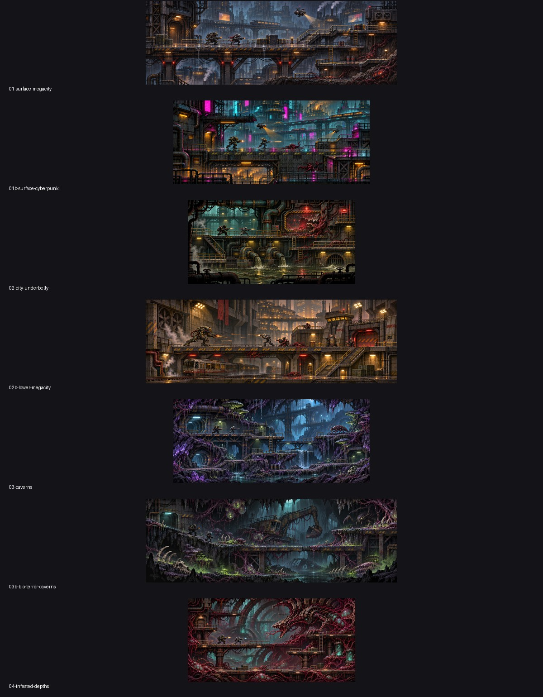

# Technophage

**An online co-op, side-scrolling shooter set in a collapsing technological dystopia.**

Fight across the surface of a sprawling megacity, descend through its industrial underbelly and enter caverns where alien life and machinery have become inseparable. Technophage draws on the movement, action and atmosphere of vintage 2D shooters, with richer, more atmospheric artwork and a world built for cooperative play.

> **Status:** playable MVP. Five zones, two-player online co-op (peer-to-peer), local co-op with a gamepad, and solo. Story, final art production and long-term scope remain open. See [Playing](#playing), [Running and deploying](#running-and-deploying) and [How it works](#how-it-works).

## The game

Technophage is intended to feel immediate, physical and dangerous: moving through a hostile space, reading threats quickly and bringing the right weapon to bear while the world presses in around the players.

The reference point for moment-to-moment action is *Abuse*: a side-view shooter with independent aiming, aggressive creatures, industrial corridors and a sense of vulnerability. Technophage takes that foundation toward an online co-op experience, with players working through environments and encounters together. The MVP decisions on controls, player count, networking, progression and encounters are listed under [MVP design decisions](#mvp-design-decisions); all of them can be revisited.

The arsenal should feel varied and substantial, from conventional industrial firepower to specialised tools adapted into weapons. Current visual concepts include a coil rifle, an incinerator and a plasma cutter. Each should have a clear silhouette and a distinct presence on screen.

## The world

The setting is a technological dystopia: an enormous, heavily controlled megacity built in layers, with a buried industrial world underneath. As players descend, the built environment gives way to contaminated caverns and eventually to xenophage-infested depths. The transition should feel gradual: failing infrastructure and organic growth increasingly occupy the same spaces.

| Zone | Character | Palette and lighting |
| --- | --- | --- |
| **Upper megacity** | Cyberpunk towers, elevated transit, dense machinery, surveillance and rain-slick walkways. | Petrol blue, dirty cyan, black steel and magenta, punctuated by sodium amber. |
| **Lower megacity** | Oppressive megablocks, brutalist canyons, checkpoints, transit infrastructure and armored authority. | Concrete ochre, iron grey, dirty yellow and warning red. |
| **Underbelly** | Dark maintenance corridors, sewers, pumping stations, corroded pipes and failing containment systems. | Oxidised teal, black iron, nicotine yellow and emergency red. |
| **Caverns** | Wet stone, fungal growth, natural passages and abandoned excavation equipment, increasingly overtaken by hostile life. | Slate, mineral violet, fungal green and cold cyan. |
| **Infested depths** | Biomechanical horror: machinery trapped in living tissue, alien growth, sacs, sinew and unsettling structures. | Bruised crimson, dried maroon, blackened bone and sickly cyan. |

The upper city should feel occupied and oppressive; the deeper regions should feel increasingly abandoned, contaminated and alive. Darkness, machinery, distant movement and sound can make spaces threatening before an enemy appears.

## Player character

Players take the role of an alien hunter: a powerful, imposing figure with an unmistakably non-human silhouette, a masked or armored face, cable-like tendrils and practical combat equipment. The initial visual direction takes cues from the **Predator** films while aiming for a distinct character and world identity.

The character should remain easy to read in motion and at gameplay scale, even against intricate machinery and dark environments. The character's identity, origins and relationship to the megacity are still open.

## Enemies and encounters

Threats change with the environment. Surface encounters lean toward augmented humans, security mechs and drones; the underbelly mixes industrial hazards with grotesque contamination; the caves and depths belong increasingly to strange organic and biomechanical life.

Concepts explored so far include:

- **Xenophage stalkers:** fast, predatory alien lifeforms with powerful limbs and chitinous silhouettes.
- **Wall bursters:** creatures that break through or inhabit industrial structures.
- **Sentient moulds and slimes:** spreading, unsettling organisms that make a space feel contaminated.
- **Biomechanical nano-swarms:** clouds of sharp mechanical fragments around a hostile core.
- **Insectoid mutants:** armored cave creatures carrying signs of fungal or alien growth.
- **Techno-rats and sewer worms:** vermin transformed by the city's waste, machinery and deeper infestation.
- **Augmented enforcers, mechs and drones:** the armed systems and personnel of the megacity above.

These are visual and encounter directions, not a finalized bestiary or a commitment to specific mechanics.

## Art direction and feel

**Gritty future industrial tech meets organic bio-terror.** Technophage should evoke the 1990s PC and 32-bit side-scrolling era while using higher-fidelity artwork, richer lighting and stronger environmental depth. It should feel nostalgic, but not constrained to the exact resolution or palette limits of an old machine.

- **Readable action:** clear character and enemy silhouettes, visible platforms, and enough separation between interactive elements and detailed scenery.
- **Tactile industry:** corroded steel, concrete, vents, pipes, cables, hazard markings, practical lights and worn equipment.
- **Living contamination:** flesh, chitin, mould, tendrils and biomechanical growth that interact with architecture rather than simply decorating it.
- **Layered spaces:** foreground structures, playable surfaces and distant architecture can move at different rates to give a side-scrolling world depth.
- **Controlled colour:** each zone has its own restrained palette; use neon, muzzle flashes, emergency lighting and bioluminescence as focal points.
- **Atmosphere with impact:** wet reflections, haze, sparks and deep shadows support the action without obscuring threats.

The aim is impressive, atmospheric pixel-styled art with the clarity and immediacy of a classic shooter. Final asset resolution, animation style and technical constraints are still to be established.

## Creative influences

These are reference points for feel and design, not settings or characters used by Technophage.

- **[*Abuse*](https://github.com/darealshinji/abuse-game):** dark industrial side-scrolling action, hostile alien creatures and independent aim while moving. The project's own [reference link](refs.md) points to an *Abuse* source port.
- **[*Duke Nukem* and *Duke Nukem II*](https://www.mobygames.com/game/1009/duke-nukem-ii/):** the original 2D games' energetic PC platform action, sci-fi machinery, weapons and side-scrolling level design.
- **[*Mega Man* and *Mega Man X*](https://megaman.capcom.com/mmxlc.html):** precise action-platforming, strong silhouettes, memorable enemy encounters and a satisfying range of weapons and abilities.
- **[*Judge Dredd* and Mega-City One](https://2000ad.com/wp-content/uploads/2019/11/40th_insert.pdf):** the scale and oppressive character of a dystopian megacity, particularly its brutalist lower levels, armored authority and dark urban atmosphere.
- ***The Terminator* and *Predator*:** industrial science-fiction menace, relentless machines, heavily armed action and the visual appeal of a formidable alien hunter.

## MVP design decisions

These were chosen for the first playable version. Each one is a starting point, not a commitment.

| Area | MVP decision |
| --- | --- |
| Player count | 1 or 2. Online: two browsers. Local: keyboard + mouse and one gamepad on one screen |
| Controls | Keyboard moves, mouse aims independently of movement (torso rotates, legs walk), as in *Abuse*. A mouse/touchpad-only scheme for laptops. Full gamepad support with twin-stick aim |
| Movement | Run, variable-height jump (about 4 tiles at full height) with coyote time and input buffering, short dash with brief invulnerability, ladders, one-way catwalks (drop through with S + Space). In toxic liquid each jump press is a swim kick, so pits can always be escaped |
| Weapons | Pulse carbine (unlimited), coil rifle (piercing rail), incinerator (flame stream), plasma cutter (short beam that also cuts breakable walls), disc charges (bouncing grenade). Ammo pickups per type |
| Power-ups | Optic camo (enemies ignore you for 10 s), overdrive (speed and fire rate for 10 s), medkits |
| Structure | Five zones in descent order: upper megacity, lower megacity, underbelly, caverns, infested depths. Each zone is built from hand-made level chunks in a seeded order, ends in a locked boss arena and an exit lift that every living hunter must board. Clearing all five starts a harder cycle |
| Co-op rules | A downed hunter bleeds out over 18 s; standing next to them revives. In a boss fight, if every hunter is down, all respawn at the arena entrance and the boss keeps the damage already done. A hunter who bleeds out respawns 4 s later beside their partner (or at the checkpoint during a boss fight). If both are down, both return to the last checkpoint. Enemy health scales ×1.6 with two players. Enemies target the nearest visible hunter |
| Progression | Weapons, ammo, kills and score carry between zones. Health resets each zone |
| Lighting | Ambient darkness per zone with additive lights: lamps, shoulder lamps that follow the aim, muzzle flashes, projectiles, explosions, drone searchlights, glowing liquids |

### Enemies in the MVP

| Enemy | Behaviour | Zones |
| --- | --- | --- |
| Augmented enforcer | Keeps a firing distance, shoots bursts | Upper, lower |
| Industrial mech | Slow, armoured, long minigun bursts | Lower |
| Security drone | Hovers above and to the side, fires bolts, sweeps a searchlight | Upper, lower |
| Xenophage stalker | Fast; pounces when close, leaps from range, dodges after being hit. In caves some hang from the ceiling as cocoons and drop when a hunter passes below (from *Abuse*'s ants) | All |
| Techno-rat | Fast, weak, jumps at obstacles | Underbelly, caverns, depths |
| Sewer worm | Travels hidden under the floor, erupts beside a hunter, spits acid, dives | Underbelly |
| Sentient mould | Stationary, lobs acid | Underbelly, caverns, depths |
| Nano-swarm | Erratic homing flight, contact damage | Most zones |
| Insectoid mutant | Armoured; winds up and charges, stuns itself on walls | Caverns, depths |
| Wall burster | Stationary nest that releases stalkers and rats while hunters are near | Upper, lower, underbelly, depths |

| Zone | Boss |
| --- | --- |
| Upper megacity | Spire Gunship: drone with spread volleys, releases nano-swarms |
| Lower megacity | Enforcement Chassis: heavy mech, long minigun sweeps and mortar volleys |
| Underbelly | Sump Leviathan: giant sewer worm |
| Caverns | Brood Matriarch: charging insectoid that spits acid and summons rats |
| Infested depths | Hive Heart: giant wall burster that spawns stalkers, swarms and rats and fires spore fans |

## Playing

Choose the control scheme in the main menu or the pause menu. *Mouse / touchpad only* is for laptops, where many touchpads stop responding while keys are held.

| Action | Keyboard + mouse | Mouse / touchpad only | Gamepad |
| --- | --- | --- | --- |
| Move | A / D | Point more than about a quarter-screen left or right of the hunter | Left stick |
| Stand and aim | Release A / D | Point near the hunter | Release stick |
| Jump | W / Space | Right click (two-finger tap); hold for height | A |
| Climb ladder | W / S | Point straight up or down | Stick up / down |
| Drop through catwalk | S + Space | Point straight down + right click | Down + A |
| Aim | Mouse | Cursor | Right stick |
| Fire | Hold left mouse | Hold left click, or click once with *Click toggles firing* on | RT |
| Disc charge | Right mouse / G | Middle click, forward side button, or G | LT |
| Dash | Shift | Back side button, or Shift | B |
| Switch weapon | 1–4, mouse wheel, E | Scroll (two-finger swipe) | LB / RB |
| Pause | Esc / P | Esc / P | Start |

The keyboard keeps working in mouse-only mode. *Click toggles firing* works in either scheme.

**Online co-op:** one player presses *Host online co-op*. A lobby opens with a 6-character room code and a *Copy invite link* button. The partner enters the code (or opens the link) and presses *Join*; they appear in the lobby and can mark themselves *Ready*. The host presses *Start* when both are ready. The host can also start alone; a partner can still join a running game.

## Running and deploying

**Play online:** https://dtresadern.github.io/baddergames/technophage/

The game is static files: no build step and no game server. It lives in the `technophage/` folder of the [`baddergames`](https://github.com/DTresadern/baddergames) repository and uses relative paths only, so it runs from any URL path.

1. Serve the repository root:

   `python3 -m http.server 8000 # run in the baddergames folder`

2. Open `http://localhost:8000/technophage/`.

   - If the menu shows *Loading assets…* forever, check the browser console. The page must be served over HTTP, not opened as a `file://` URL, because ES modules and `fetch` need HTTP.

3. Deploy by pushing to `main`. The workflow `.github/workflows/pages.yml` (in the repository root) copies the runtime files (`index.html`, `style.css`, `peer-config.js`, `src/`, `assets/`, `vendor/`) to `/technophage/` on GitHub Pages. `generated-art/`, `art-references/` and `tools/` are not published.

   - Check a deploy: `gh run list --workflow pages.yml --limit 1 # run in the baddergames folder`
   - If it failed: `gh run view --log-failed`

### Online play requirements

- Signalling uses the public PeerJS server `0.peerjs.com`. If it is down, online play is unavailable; solo and local co-op still work.
- Players behind strict NAT (common on mobile data) need a TURN relay. PeerJS 1.5.5's own TURN hosts (`eu-0.turn.peerjs.com`, `us-0.turn.peerjs.com`) had no DNS record when checked on 14 Nov 2026. Add your own TURN server in `peer-config.js` (Cloudflare TURN, Metered, or self-hosted coturn).
- To remove the dependency on the public signalling server, run [`peerjs-server`](https://github.com/peers/peerjs-server) and set `host`, `port`, `path` and `secure` in `peer-config.js`.

## How it works

| Part | Implementation |
| --- | --- |
| Rendering | Canvas 2D at 960×540, scaled to the window, nearest-neighbour. Far layer: the generated scene art, blurred and darkened, at 1/8 parallax (*Abuse*'s ratio). Mid layer: procedurally generated silhouettes per zone. Level tiles: procedural pixel art per zone, rendered once into 512 px strips; blood and scorch marks are stamped into them |
| Lighting | A half-resolution light map filled with the zone's ambient colour, lights added with `lighter`, then multiplied over the scene. Emissive effects are drawn after lighting so they glow |
| Sprites | `tools/build-assets.py` converts `generated-art/` into `assets/`: removes the dark halos, downscales, splits the hunter into legs and an aiming torso, makes a cyan-lit player 2 variant, blurs and darkens the scenes. Animation is procedural (gait shear, bob, squash, tilt), with sprite-fragment gibs |
| Simulation | Fixed 60 ticks per second (`src/sim.js`, `src/enemies.js`, `src/level.js`). No DOM access, so it also runs in Node for tests |
| Networking | PeerJS 1.5.5 (WebRTC data channel, reliable, raw strings), self-hosted in `vendor/`. The host's browser runs enemies, damage, pickups and level state and sends a snapshot 30 times a second. Each player's own browser simulates their own movement, aim and weapons, so local controls respond instantly. Shots are sent as "weapon, origin, angle, seed" and simulated identically on both sides; only damage is decided by the host |
| Network safety | Messages over 16 KB (guest to host) are dropped, more than 200 messages a second are dropped, every received number is clamped, names are filtered to `A–Z 0–9 _ . ' -` (max 12) and shown with `textContent`. Guest shots are rate-limited per weapon and must start near the guest's reported position |
| Audio | Recorded effects in `assets/sfx/` (weapons, impacts, creatures, interface), cut and normalised from the sound packs by `tools/build-sounds.py`; the picks and trims are listed in that script. The incinerator and plasma cutter use looped sounds that play while the trigger is held. Slots without a recording (jump, disc bounce, ambience) are synthesised with Web Audio. Positional panning, a shared reverb, per-zone ambient drones and rain. Low-health heartbeat as in *Abuse* |
| Hidden tab | A worker timer keeps the host simulating when its tab is in the background, because browsers pause `requestAnimationFrame` in hidden tabs |

### Source layout

| Path | Contents |
| --- | --- |
| `index.html`, `style.css` | Page, menus, overlays |
| `peer-config.js` | Optional PeerJS server and TURN settings |
| `src/main.js` | Boot, menus, game loop, online session handling |
| `src/sim.js` | World state, players, weapons, projectiles, pickups, arena, snapshots |
| `src/enemies.js` | Enemy and boss definitions and AI |
| `src/level.js` | Level chunks, seeded generation, tile collision |
| `src/render.js`, `src/tiles.js` | Drawing, lighting, particles, HUD, procedural tile art |
| `src/net.js` | PeerJS and BroadcastChannel transports, message limits |
| `src/audio.js`, `src/input.js`, `src/assets.js` | Sound, input, asset loading |
| `tools/build-assets.py` | Regenerates `assets/` from `generated-art/` (Pillow) |
| `tools/simtest.mjs` | Headless bot test that plays every zone |
| `vendor/` | PeerJS 1.5.5 and its licence |

### Development

| Task | Command or URL |
| --- | --- |
| Rebuild assets after changing art | `python3 tools/build-assets.py # run in technophage/` |
| Bot plays all five zones, solo | `node tools/simtest.mjs 1 3 # in technophage/: 1 player, 3 seeds per zone` |
| Bot plays all five zones, two players | `node tools/simtest.mjs 2 1` |
| Bot test for one zone, with boss-fight trace | `node tools/simtest.mjs 2 1 --zone 2 --trace` |
| Check every level chunk can be crossed and has no dead ends (real movement physics, no teleporting) | `node tools/reachability.mjs strict # walking, full jumps and ladders only` |
| Same check on full generated levels | `node tools/reachability.mjs full 6 strict # 6 seeds per zone` |
| Start solo in a given zone | `http://localhost:8000/technophage/?autostart=solo&zone=3` |
| Online co-op in two tabs without a network | open `?net=local&autostart=host`, then `?net=local&room=CODE&autostart=join` in a second tab, then press *Start* in the first |
| Simulate network delay | add `&lag=150` to a tab's URL: everything that tab sends is delayed by 150 ms |
| Rebuild sound effects from the sound packs | `python3 tools/build-sounds.py # in technophage/; reads ../../soundpacks by default, catalogue in soundpacks/INDEX.md` |
| Version shown on the main menu | `VERSION` in `src/config.js`; the deploy adds the commit and build date |
| Playtest balance | `TUNING` in `src/config.js`: boss and enemy health multipliers |

`simtest.mjs` keeps the bot alive and nudges it past obstacles, so it checks that the simulation raises no errors and that bosses can be beaten, not that levels can be traversed. `reachability.mjs` checks traversal: run it after editing level chunks in `src/level.js`; both modes must print `ALL PASSABLE, NO TRAPS`.

### Known limitations

- Host leaves, game ends for the guest. There is no host migration.
- The host's browser decides damage, so a modified host client can cheat. Acceptable for co-op between friends; a leaderboard would need a dedicated server.
- Room codes are 6 characters from 32 symbols (about 1 billion combinations). A stranger who guesses a live code could join.
- Enemy shots are checked against where the host last saw the guest, so on a slow connection the guest can be hit by a shot that appeared to miss.
- No touch controls. No save between browser sessions.
- Hunter animation is procedural on a single static pose; enemies too. Animated sprite sheets are the main art task for production. The requests for the art session are in [`docs/animation-handover.md`](docs/animation-handover.md) and [`docs/programmer-art-handover.md`](docs/programmer-art-handover.md).

## Project materials

- `art-references/`: supplied screenshots from other games, used for visual research. Kept locally only; not tracked in git (listed in the repository's `.gitignore`).
- [`generated-art/`](generated-art/) — original location, character, enemy, weapon and prop concepts, with prompt and review records.
- [Scene overview](generated-art/scene-overview.jpg) · [Asset overview](generated-art/asset-overview.jpg) · [Visual development notes](generated-art/README.md)

The current location images are flattened mockups, and the individual characters and enemies are static concepts. They are starting points for art direction, not finished production assets or animation sheets. The MVP uses them as processed placeholders through `tools/build-assets.py`.
